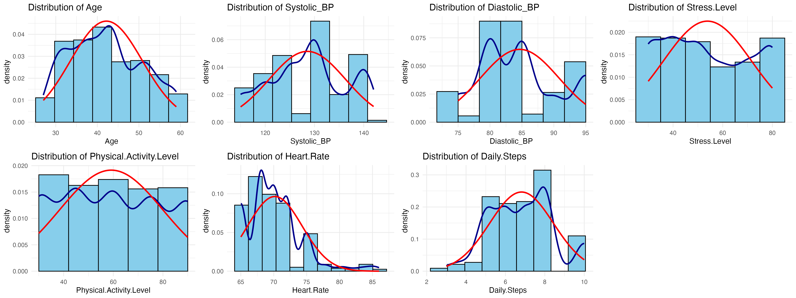

# Análisis de Salud y Sueño

**English summary.** Predicts whether a person has a sleep disorder (insomnia or sleep apnea vs. none) from health and lifestyle variables, comparing logistic regression, LDA, a decision tree (full and pruned) and a random forest in R. Dataset: 374 people from the Kaggle "Health and Sleep Relation 2024" dataset. On a stratified 80/20 split (74 test rows), logistic regression reached 0.919 accuracy (kappa 0.832) and the pruned tree 0.932 (kappa 0.859); the random forest had a 5.61% out-of-bag error. Stress level, diastolic blood pressure, BMI category and daily steps were the strongest predictors across models. Full write-up (in Spanish): [`Reporte.pdf`](Reporte.pdf).

---

## Descripción

Proyecto de clasificación binaria: predecir **Problemas de Sueño** (Sí = insomnio o apnea, No = sin trastorno) a partir de edad, género, categoría de IMC, presión sistólica y diastólica, nivel de estrés, actividad física, frecuencia cardíaca y pasos diarios. Las variables de duración y calidad del sueño se excluyen a propósito para no predecir el sueño con medidas del propio sueño.

Datos: [Health and Sleep Relation 2024 (Kaggle)](https://www.kaggle.com/datasets/orvile/health-and-sleep-relation-2024), 374 observaciones (219 sin trastorno, 77 insomnio, 78 apnea).

## Metodología

1. Limpieza: variables categóricas a factores, separación de la presión arterial en sistólica y diastólica, unificación de categorías de IMC.
2. Revisión de supuestos (normalidad, prueba de Levene) antes de LDA.
3. Partición estratificada 80/20 con `caret::createDataPartition` (`set.seed(123)`).
4. Modelos: regresión logística con selección por pasos (stepwise AIC), LDA, árbol de decisión (`rpart`, original y podado) y random forest (500 árboles).
5. Evaluación con matrices de confusión, sensibilidad, especificidad y kappa.

## Resultados

Valores tomados de `Reporte.pdf` (conjunto de prueba de 74 observaciones salvo donde se indica):

| Modelo | Accuracy | Sensibilidad | Especificidad | Kappa |
|---|---|---|---|---|
| Regresión logística (stepwise) | 0.919 | 0.871 | 0.954 | 0.832 |
| LDA | 0.892 | 0.871 | 0.907 | 0.778 |
| Árbol (original) | 0.919 | 0.871 | 0.954 | 0.832 |
| Árbol (podado) | 0.932 | 0.977* | 0.871* | 0.859 |
| Random forest (error OOB, 374 obs.) | 0.944 | 0.923 | 0.959 | 0.884 |

\* Ver limitaciones.

Variables más importantes: nivel de estrés, presión diastólica, categoría de IMC y pasos diarios (y edad en el random forest). En la regresión logística, el sobrepeso tiene un odds ratio de 10.82.

## Cómo ejecutarlo

1. Descargar el dataset de Kaggle.
2. Abrir `Analisis de Sueño.Rmd` en RStudio y cambiar la ruta del `read_csv` (línea 36) a la ubicación del CSV.
3. Instalar los paquetes de la sección de librerías (`caret`, `randomForest`, `rpart`, `MASS`, `MVN`, `GGally`, entre otros) y ejecutar o tejer (knit) el documento.

## Limitaciones

* Muestra pequeña (374 personas) y de una sola fuente; los resultados no deberían generalizarse sin validación externa.
* El random forest se entrena con todos los datos y se evalúa con su error out-of-bag, no con las mismas 74 observaciones de prueba que los demás modelos, así que la comparación no es exactamente pareja.
* En el árbol podado, `confusionMatrix` no fija `positive = "Yes"`, por lo que su sensibilidad y especificidad están calculadas tomando "No" como clase positiva (invertidas respecto a las demás filas).
* Datos transversales: las asociaciones encontradas no implican causalidad.
